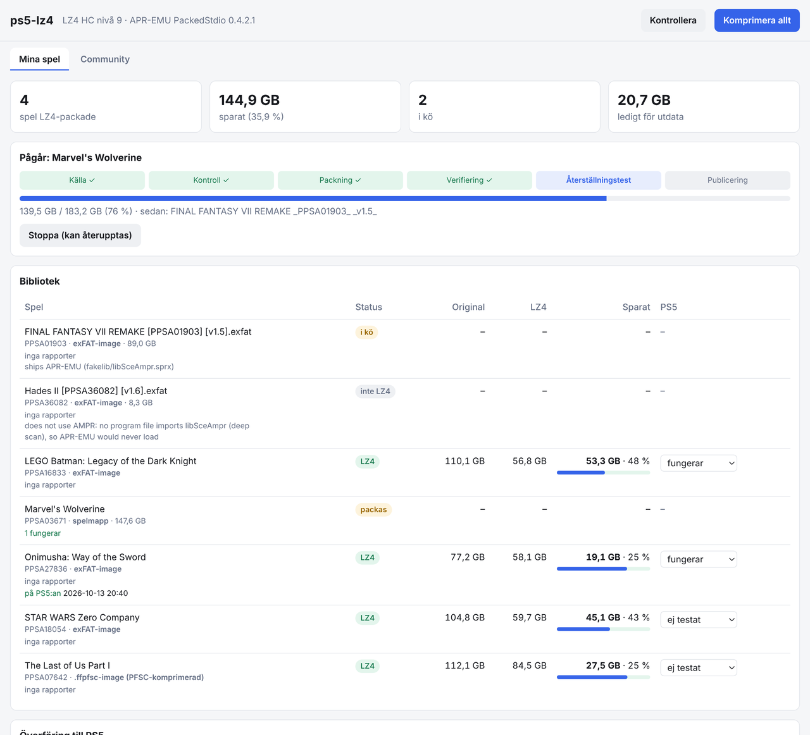

# PS5-LZ4-NAS

Pack PS5 games with **LZ4 HC for APR-EMU on a NAS**, check them byte for byte,
and send them to the console, all from a web page. Nothing runs on the PS5
except the game. A fork of
[theghostonline/PS5-LZ4-Compression](https://github.com/theghostonline/PS5-LZ4-Compression),
kept in sync with it every six hours.

Full guide: [nas-lz4/README.md](../nas-lz4/README.md).



## What it does

- **LZ4 HC packs** (`AMPRPAK4` / `AMPRDAT3`) built with the original project's
  packer, level 9 by default, plus the pinned **APR-EMU PackedStdio 0.4.2.1**
  runtime in `fakelib/libSceAmpr.sprx`, the only build that reads packs.
- **Sources:** game folders, `.exfat`, `.ffpfs` and `.ffpfsc` images. Images
  are unpacked on the NAS with MkPFS; `.ffpfsc` inner images are checked
  against their `.vhash` sidecar when one exists.
- **Checks before anything is published:** every chunk decoded and compared
  with the original, then a full unpack compared byte for byte. Games that
  don't use AMPR are skipped with the reason.
- **Originals are never changed:** the library is mounted read-only.
- **Web page** (port 5921): library with LZ4 status, source type and size,
  live job steps and progress, savings per game, one-click **Komprimera**,
  **Kontrollera** (read-only check) and **Komprimera allt** (compress every game
  that can be LZ4, repairing finished ones), and the **community game reports** from the original project
  on every title and in their own tab.
- **Send to the PS5** over FTP (ftpsrv, port 2121): SELF decryption turned off,
  every file size checked, program files compared by SHA-256, duplicate title
  IDs refused (ShadowMountPlus mounts one copy per title), interrupted
  transfers resumed.
- **Wake the PS5 from rest mode** before a transfer, and **pair** with it
  (Remote Play PIN and account ID, also for a fake signed-in account), the way
  Chiaki does.
- **Docker image** `ghcr.io/dviree/ps5-lz4:latest`, rebuilt after every change
  and upstream sync; Watchtower keeps it updated and waits while a game is
  packed. An interrupted queue resumes on container start.

## Install

On the NAS, as root:

```sh
mkdir -p /volume2/docker/ps5-lz4 && cd /volume2/docker/ps5-lz4
curl -fL https://github.com/dviree/PS5-LZ4-NAS/archive/refs/heads/main.tar.gz | tar xz
mv PS5-LZ4-NAS-main src
bash src/nas-lz4/install.sh --check      # look only
nohup bash src/nas-lz4/install.sh > install.log 2>&1
```

Paths and user are set with environment variables (`LIBRARY`, `OUTPUT`,
`BASE`, `NAS_USER`, `UI_PORT`); see the guide. Then open
`http://<NAS IP>:5921`.

## Layout

| Path | What |
| --- | --- |
| `nas-lz4/` | NAS tool: `ps5lz4.py` (CLI, web page, agent, FTP transfer), `ui.html`, `install.sh`, Dockerfile |
| `nas-lz4/ps5regist.py` | Remote Play pairing, ported from chiaki-ng (AGPL-3.0) |
| `nas/` | The original engine's web app built for Linux (port 5920) |
| `src/`, `app/`, `tests/` | The original project (PS5 app and packer) |

## Credits

- [theghostonline/PS5-LZ4-Compression](https://github.com/theghostonline/PS5-LZ4-Compression):
  the packer, profiles and community reports (GPL-3.0).
- [drakmor/ampr_emu](https://github.com/drakmor/ampr_emu): APR-EMU, and
  [drakmor/ShadowMountPlus](https://github.com/drakmor/ShadowMountPlus).
- [streetpea/chiaki-ng](https://github.com/streetpea/chiaki-ng): Remote Play
  discovery, wake-up and registration (AGPL-3.0).
- [MkPFS](https://pypi.org/project/mkpfs/) for exFAT and PFS images,
  [ps5-payload-dev/ftpsrv](https://github.com/ps5-payload-dev/ftpsrv) on the console.

Use it with games you own. Verified on the NAS is not the same as tested on
the PS5: mark the result per game on the web page and share it with the
community.
